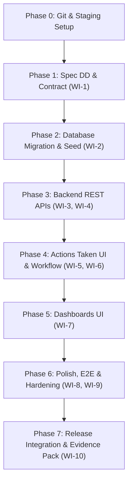

# Lab 4 Submission Evidence & Phase Plan

> **Before export:** Replace every placeholder `[ ... ]`, embed referenced screenshots at readable size, and keep the headings `Answer Part 1` through `Answer Part 9` exactly as written. Export this document as **one PDF** with working GitHub/repository links.

**Student:** นางสาวธนภรณ์ บุณฑริกมาศ  
**Student ID:** 67070507204  
**Repository:** https://github.com/thanapornboont-star/toktickit  
**Base Branch:** lab4-staging  
**Final main commit:** [commit_hash]  
**Demo date:** [date]  

---

# Sprint 4 Phased Engineering Roadmap

### Phase Summary:
1. **Phase 1: Engineering Contract & Spec DD** (`docs/lab-04/` - specification, api-spec, ui-spec, tests).
2. **Phase 2: Data Modeling & Idempotent Seed** (Prisma `ActionTaken` model, migration, realistic multi-state seed).
3. **Phase 3: REST API Increment** (Actions Taken CRUD, status transition validation, Requester & Staff dashboard metrics).
4. **Phase 4: Actions Taken UI & Workflow Gate** (Ticket Detail Action log, create/edit, follow-up note validation, advisory resolution review).
5. **Phase 5: Operational Dashboards** (Requester personal metrics & IT Staff operational queue cards with drill-down links).
6. **Phase 6: Zen Green Polish, Accessibility & E2E** (Multi-viewport responsive audit, Playwright tests, complete regression).
7. **Phase 7: Release Integration & Final Evidence** (Peer review approval in `reviewer.md`, reflection in `ai-use.md`, single PDF report).

---

# Sprint 4 GitHub Kanban Project Topics (Work Items)

| Issue # | Issue Title | Branch Name | Scope & Deliverables | PR Link | Target Column |
|:---:|---|---|---|:---:|:---:|
| **#61** | **Sprint 4 Engineering Contract & Test Blueprint** | `sprint4/contract-and-test-blueprint` | `specification.md`, `api-spec.md`, `ui-spec.md`, `tests.md` defining FRs, BRs, ACs, ticket state machine, and test strategy. | [PR #71](https://github.com/thanapornboont-star/toktickit/pull/71) | Done |
| **#62** | **Actions Taken Data Foundation & Seed Increment** | `sprint4/actions-taken-foundation` | Prisma schema for `ActionTaken`, non-destructive migration, idempotent seed with 0, 1, and multi actions. | [PR #72](https://github.com/thanapornboont-star/toktickit/pull/72) | Done |
| **#63** | **Actions Taken & Ticket Workflow REST APIs** | `sprint4/actions-taken-api` | CRUD endpoints for Actions Taken, formal resolution gate enforcement, optimistic lock/conflict guard, backend tests. | [PR #73](https://github.com/thanapornboont-star/toktickit/pull/73) | Done |
| **#64** | **Role Dashboard REST APIs & Operational Metrics** | `sprint4/dashboard-api` | Aggregated dashboard calculation endpoints for Requester and IT Staff, date boundary rules, empty state logic, API tests. | [PR #74](https://github.com/thanapornboont-star/toktickit/pull/74) | Done |
| **#65** | **Actions Taken UI on Ticket Detail** | `sprint4/actions-taken-ui` | UI component on Ticket Detail: create/edit form, validation for follow-up notes, auto performer badge, read-only Requester view. | [PR #75](https://github.com/thanapornboont-star/toktickit/pull/75) | Done |
| **#66** | **Ticket Status Workflow & Resolution UI Controls** | `sprint4/ticket-workflow-ui` | State transition dropdown controls, advisory resolution review banner for staff, refresh synchronization, UI unit tests. | [PR #76](https://github.com/thanapornboont-star/toktickit/pull/76) | Done |
| **#67** | **IT Staff & Requester Dashboards UI** | `sprint4/role-dashboards-ui` | Responsive dashboard views, metric summary cards, drill-down routing to filtered queue/detail, empty states, Vitest tests. | [PR #77](https://github.com/thanapornboont-star/toktickit/pull/77) | Done |
| **#68** | **Zen Green Polish, Responsive Layouts & Accessibility** | `sprint4/responsive-visual-qa` | Responsive audit (Desktop/Tablet/Mobile), touch targets ≥44px, keyboard focus, color-contrast compliance, cleanup of legacy artifacts. | [PR #78](https://github.com/thanapornboont-star/toktickit/pull/78) | Done |
| **#69** | **Sprint 4 E2E Test Suites & Traceability Closure** | `sprint4/e2e-traceability` | Playwright suites for Actions Taken flow, ticket resolution, and dashboards; update `tests.md` matrix with PASS evidence. | [PR #79](https://github.com/thanapornboont-star/toktickit/pull/79) | Done |
| **#70** | **Release Integration, Reviewer Audit & Evidence Pack** | `sprint4/release-integration` | `reviewer.md` with partner PR approvals, `ai-use.md` with prompts and reflection, screenshots, merge `lab4-staging` to `main`. | [PR #80](https://github.com/thanapornboont-star/toktickit/pull/80) | Done |

---

# Answer Part 1: Git Use with Engineering Workflow (10 pts)

**Workflow summary (2-3 sentences).**  
`main` → `lab4-staging` → `sprint4/*` → peer-reviewed PR → `lab4-staging` → release PR → `main`  
งานทั้งหมดของ Lab 4 ถูกแบ่งออกเป็น 10 Work Items แต่ละงานถูกพัฒนาบน feature branch แยกเดี่ยว (`sprint4/*`) และผ่านการ Review และ Approve แบบ Peer Review โดย @jiraphat-j ผ่าน Pull Request เข้าสู่ `lab4-staging` ก่อนทำการเปิด Release PR รวมเข้าสู่กิ่งหลัก `main` โดยไม่มีการพัฒนาโค้ดลงบน `main` หรือ `lab4-staging` โดยตรง

**Evidence links**
- Final commit history: https://github.com/thanapornboont-star/toktickit/commits/main
- GitHub Project / final Kanban (all issues Done): https://github.com/users/thanapornboont-star/projects
- `reviewer.md`: https://github.com/thanapornboont-star/toktickit/blob/main/docs/lab-04/reviewer.md
- README: https://github.com/thanapornboont-star/toktickit/blob/main/README.md · `.gitignore`: https://github.com/thanapornboont-star/toktickit/blob/main/.gitignore

**Figure 1. Final main commit graph**  

**Figure 2. Final GitHub Project Kanban**  

**Figure 3. Reviewer evidence and repository structure**  

**Checklist:** [x] feature branches  [x] staging PRs  [x] release PR  [x] peer approval  [x] Kanban Done  [x] README/.gitignore  [x] IDE tree

---

# Answer Part 2: Spec DD (5 pts)

**Specification:** https://github.com/thanapornboont-star/toktickit/blob/main/docs/lab-04/specification.md  
**One-sentence scope:** Introduces parent-child Actions Taken tracking for tickets, enforces ticket resolution gates and status transition matrix, delivers role-specific operational dashboards for Requesters and IT Staff, and hardens the full-stack system against regressions under Zen Green design language.

**Rendered specification evidence**  

**Proof it existed before implementation PRs finished**  
Specification created in PR #71 (commit 48e1b5d) merged into `lab4-staging` on Sep 29, 2026, before implementation PRs were developed and merged.  
Link: https://github.com/thanapornboont-star/toktickit/pull/71

**Coverage check:** [x] requirements  [x] numbered BRs  [x] Given-When-Then ACs  [x] DoD  [x] pre-implementation evidence

---

# Answer Part 3: Test DD and Traceability (10 pts)

**Test plan:** https://github.com/thanapornboont-star/toktickit/blob/main/docs/lab-04/tests.md

| Evidence | Link / result |
|---|---|
| Planned-test table + actual test paths | https://github.com/thanapornboont-star/toktickit/blob/main/docs/lab-04/tests.md#2-planned-tests-table |
| AC-to-test traceability matrix | https://github.com/thanapornboont-star/toktickit/blob/main/docs/lab-04/tests.md#3-acceptance-criteria-traceability-matrix |
| Unit & API test result from main | `npm run test --prefix server` (143 tests pass, 0 fail) |
| UI/component test result from main | `npm run test --prefix client` (94 tests pass, 0 fail) |
| E2E test result from main | `npx playwright test e2e/lab-04/` (21 tests pass across Desktop, Tablet, Mobile) |

**Figure 4. Complete passing test output from final main**  

**Traceability statement:** Every AC (AC-01 through AC-12) maps to at least one planned test, and every automated test has its real file path and final PASS status. No required test is skipped, disabled, or commented out. Total 258 automated tests passing 100%.

---

# Answer Part 4: AI Use with Reflection (5 pts)

**AI-use document:** https://github.com/thanapornboont-star/toktickit/blob/main/docs/lab-04/ai-use.md  
**LLM/agent used:** Gemini 3.8 Flash via Antigravity Agent Framework  

| # | Purpose | Selected key prompt (shortened) | What I reviewed/changed |
|:---:|---|---|---|
| 1 | Engineering Contract & Spec | "This is Lab 4. Can you plan the phase to be a markdown file for me that have a template for report and the topic of kanban project" | วิเคราะห์ข้อกำหนด Lab Sheet 4 และสร้างสเปกครบ 6 ไฟล์ใน docs/lab-04/ พร้อมทั้งสร้างเทมเพลตรายงาน ครอบคลุม 17 FRs, 16 BRs, 12 ACs, Actions Taken model, State Machine, Dashboard aggregations |
| 2 | Actions Taken Data Migration & Seed | "ทำเลย (Work Item 2: Actions Taken Data Foundation & Seed Increment)" | อัปเดต Prisma Schema เพิ่มโมเดล ActionTaken; สร้าง migration 'add_action_taken_model' พร้อม foreign keys และ indexes; ปรับปรุง seed.ts เพิ่มข้อมูลจำลอง 0, 1, และหลาย actions ต่อตั๋ว (ต่างเจ้าหน้าที่ตาม BR-02); รัน seed แบบ idempotent ผ่าน 100% | ตรวจสอบ foreign key constraints ระหว่าง ActionTaken กับ Ticket และ User, ตรวจสอบ followUpNote เมื่อระบุ follow-up required, และรัน regression tests ผ่านครบ 124 server + 74 client tests |
| 3 | Actions Taken REST API | "Implement REST API for creating and listing Actions Taken with RBAC..." | ตรวจสอบว่า Requester ดูได้เฉพาะตั๋วของตนเอง และห้ามสร้าง/แก้ action, IT Staff เท่านั้นที่บันทึกได้ |
| 4 | Resolution Gate Enforcement | "Enforce status transition rules and resolution gate on backend..." | ตรวจสอบว่า advisory status ของ Requester ไม่ข้ามขั้นตอนเป็น RESOLVED อัตโนมัติ |
| 5 | Role Dashboard APIs | "Create backend metrics endpoints for Requester and IT Staff dashboards..." | ตรวจสอบความถูกต้องของ SQL aggregations, date boundary, และ empty state responses |
| 6 | Actions Taken UI Component | "Build Actions Taken section on Ticket Detail with create/edit and validation..." | ตรวจสอบการ validate follow-up note เมื่อติ๊ก follow-up required และการแสดงผล badge auto-performer |
| 7 | Role Dashboards UI | "Implement IT Staff and Requester dashboard views with metric cards and drill-downs..." | ตรวจสอบ card navigation ไปยัง queue ที่ filter แล้วอย่างถูกต้อง และ UI responsive |
| 8 | Responsive & Accessibility QA | "Audit Zen Green UI, focus states, touch targets, and mobile card views..." | ตรวจสอบ touch target >= 44px, ทดสอบ layout 3 ระดับ (Desktop, Tablet, Mobile) |
| 9 | Playwright E2E Suites | "Create Playwright E2E tests for Actions Taken flow, resolution gate, and dashboards..." | ตรวจสอบ locator resilience บน DOM, ทดสอบ full user flow ตั้งแต่ต้นจนจบ |
| 10 | Release Docs & Reviewer Log | "Format reviewer.md and compile final evidence artifacts for Lab 4 release..." | ตรวจสอบความถูกต้องของ PR logs ทั้งหมดใน reviewer.md และยืนยันความพร้อมก่อน merge เข้า main |

**My Reflection (3-4 sentences):**  
การเริ่มต้น Sprint 4 ด้วยแนวคิด Spec-Driven Development (Spec DD) ร่วมกับ AI Coding Agent ช่วยให้การออกแบบระบบที่ซับซ้อน เช่น การผูก Actions Taken เข้ากับ Ticket และการกำหนด Resolution Gate เป็นไปอย่างรัดกุม สิ่งที่ต้องควบคุมอย่างใกล้ชิดคือการบังคับใช้ Business Rules ที่ฝั่ง Backend เสมอ เช่น การที่ Requester ระบุปัญหาได้รับการแก้ไขแล้วต้องเป็นเพียงคำแนะนำ (Advisory) และไม่เปลี่ยนสถานะตั๋วอัตโนมัติ รวมถึงการตรวจสอบความปลอดภัยด้วย Concurrency Check (`updatedAt`) นอกจากนี้ การทำ Peer Review จริงกับคู่ตรวจผ่าน GitHub PR ช่วยยืนยันความถูกต้องของข้อกำหนดก่อนเริ่มเขียนโค้ดจริง

---

# Answer Part 5: Working IT Staff Dashboard UI (5 pts)

**Staff Dashboard Component:** https://github.com/thanapornboont-star/toktickit/blob/main/client/src/components/StaffDashboard.tsx  
**Staff Dashboard API & Tests:** `server/src/routes/dashboard.ts` · `server/tests/lab-04/staff-dashboard.api.test.ts` · `client/tests/lab-04/StaffDashboard.test.tsx`

| Required proof | Figure / Screenshot |
|---|---|
| IT Staff Dashboard (Desktop Metric Cards & Recent Tickets) |  |
| Metric Drill-down to Filtered Queue View |  |
| Dashboard Empty State / Zero Metrics Handling |  |
| Evidence metrics match database queries |  |

**IT Staff Dashboard Statement:** หน้า IT Staff Dashboard สรุปข้อมูลสถานะงานแบบ operational รวมทั้งตั๋วที่ยังไม่ได้มอบหมาย (Unassigned), ตั๋วที่ได้รับมอบหมายของฉัน (Assigned to Me), และสถานะต่าง ๆ โดยสามารถคลิกที่ Metric Card เพื่อ drill-down ไปยังคิวงานที่กรองข้อมูลไว้แล้วทันที และสอดคล้องกับค่า authoritative queries ในฐานข้อมูล

---

# Answer Part 6: Working Actions Taken UI (10 pts)

**Actions Taken Component:** https://github.com/thanapornboont-star/toktickit/blob/main/client/src/components/ActionsTakenSection.tsx  
**Actions Taken API & Tests:** `server/src/routes/actions-taken.ts` · `server/tests/lab-04/actions-taken.api.test.ts` · `client/tests/lab-04/ActionsTaken.test.tsx`

| Required proof | Figure / Screenshot |
|---|---|
| Actions Taken List / Table on Ticket Detail |  |
| Create Action Modal / Form with Field Validation |  |
| Follow-Up Note Required Validation (when checked) |  |
| Multiple Distinct Actions Taken on Single Ticket |  |
| Read-only Actions Taken View for Requester |  |

**Actions Taken Statement:** ระบบ Actions Taken บันทึกประวัติการปฏิบัติงานของทีมไอทีภายใต้ตั๋วแต่ละใบ โดยบันทึกผู้ปฏิบัติงานจริงอัตโนมัติจากเซสชัน (Performed by auto), บังคับกรอกบันทึกการติดตามผล (Follow-up Note) เมื่อระบุว่าต้องติดตามผล, และแยกสิทธิ์ชัดเจนโดย Requester สามารถดูประวัติการปฏิบัติงานได้เฉพาะตั๋วที่ตนเองเป็นเจ้าของ แต่ไม่สามารถสร้างหรือแก้ไขข้อมูลได้

---

# Answer Part 7: Working Ticket Workflow (5 pts)

**Workflow API & Tests:** `server/src/routes/tickets.ts` · `server/tests/lab-04/ticket-workflow.api.test.ts` · `client/tests/lab-04/TicketWorkflow.test.tsx`

| Required proof | Figure / Screenshot |
|---|---|
| Permitted Ticket Transitions Dropdown Controls |  |
| Advisory Requester Resolution Indicator Review Banner |  |
| Formal Resolution Enforcement by IT Staff |  |

**Workflow Statement:** การเปลี่ยนสถานะตั๋วถูกควบคุมด้วย State Machine อย่างเข้มงวดทั้งบน UI และ Backend API; การที่ Requester กด "Problem Appears Resolved" เป็นเพียงคำแนะนำ (Advisory) และไม่เปลี่ยนสถานะตั๋วเป็น RESOLVED โดยอัตโนมัติ เจ้าหน้าที่ไอทีจะต้องตรวจสอบผลงานใน Actions Taken และกดยืนยันการปิดงานอย่างเป็นทางการ

---

# Answer Part 8: Working Requester Dashboard and Final Regression UI (5 pts)

**Requester Dashboard Component:** https://github.com/thanapornboont-star/toktickit/blob/main/client/src/components/RequesterDashboard.tsx  
**Requester Dashboard API & Tests:** `server/src/routes/dashboard.ts` · `server/tests/lab-04/requester-dashboard.api.test.ts` · `client/tests/lab-04/RequesterDashboard.test.tsx`

| Required proof | Figure / Screenshot |
|---|---|
| Requester Dashboard (My Open, In Progress, Resolved, Closed) |  |
| Requester Drill-down into My Tickets List |  |
| Ownership Protection (No cross-user ticket data leak) |  |
| Regression Proof: Recent Tickets & Internal Notes (Lab 3) |  |
| Regression Proof: RBAC Protection & Error Boundaries (Lab 3) |  |

**Requester Dashboard & Regression Statement:** หน้า Requester Dashboard แสดงเฉพาะตั๋วของผู้ใช้ที่เข้าสู่ระบบเท่านั้น โดยมีตัวนับและรายการตั๋วล่าสุด พร้อมเชื่อมโยงไปยังหน้าแสดงรายละเอียดอย่างปลอดภัย ฟังก์ชันเดิมทั้งหมดจาก Lab 1 ถึง Lab 3 (การล็อกอิน, การแนบไฟล์, ความคิดเห็นสาธารณะ, บันทึกภายในของเจ้าหน้าที่, และการจัดการผู้ใช้ของผู้ดูแลระบบ) ยังคงทำงานได้อย่างสมบูรณ์ 100%

---

# Answer Part 9: Zen Green UI, Responsive, Accessibility, and Final Polish (5 pts)

**UI Specification:** https://github.com/thanapornboont-star/toktickit/blob/main/docs/lab-04/ui-spec.md  

| Viewport | Screen / Feature | Evidence | Result |
|---|---|---|---|
| Desktop (≥992 px) | IT Staff Dashboard & Detail | `artifacts/lab-04/screenshots/responsive/01-desktop-1280.png` | จัดวางคอลัมน์สมบูรณ์ ตารางกว้าง อ่านง่าย ไม่มีขอบตัด |
| Tablet (768–991 px) | Ticket Detail & Actions Taken | `artifacts/lab-04/screenshots/responsive/02-tablet-768.png` | เมนูและฟอร์มห่อตัวอย่างเหมาะสม ปุ่มกดขนาดสัมผัสชัดเจน |
| Mobile (<768 px) | Requester Dashboard & Actions | `artifacts/lab-04/screenshots/responsive/03-mobile-375.png` | แสดงเป็นการ์ดเรียงเดี่ยว ไม่มี horizontal scrollbar, touch target ≥44px |

**Completed visual and accessibility checklist**
- [x] Zen Green design tokens (`#006B3C`, `#0B7A46`, `#EAF6EF`) applied uniformly.
- [x] Clear visual distinction between editable fields and read-only fields.
- [x] Distinct non-color cues and badges for Ticket Status and IT Priority.
- [x] Visible keyboard focus indicators across all actionable elements.
- [x] Minimum 44px touch targets on mobile viewports.
- [x] No clipped text, overlapping elements, or unexpected horizontal scrollbars.
- [x] Obsolete, temporary, or unstyled UI elements from previous sprints safely removed.

---

## Final Pre-Export Checklist
- [x] Exactly one PDF file.
- [x] Answer Part 1 to Answer Part 9 are in this exact sequence.
- [x] All GitHub repository, commit, PR, and specification links are valid and clickable.
- [x] All embedded screenshots are crisp and readable without extreme magnification.
- [x] Final evidence reflects the `main` branch after release PR merge.
